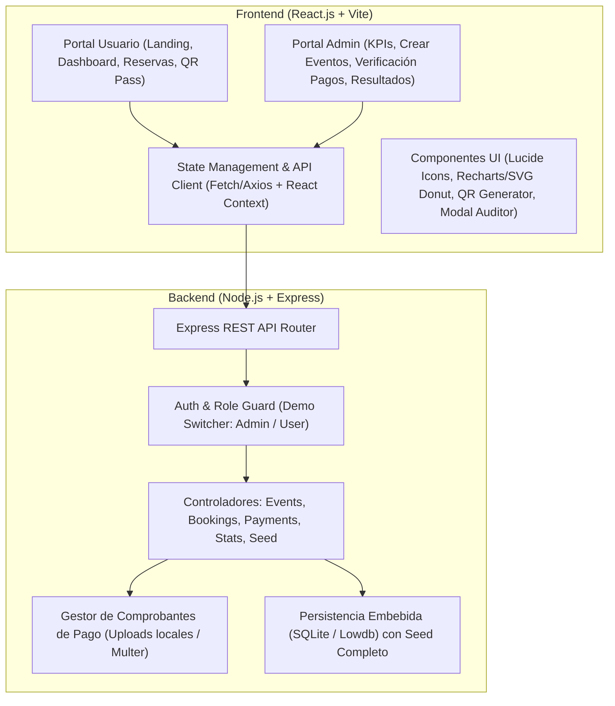
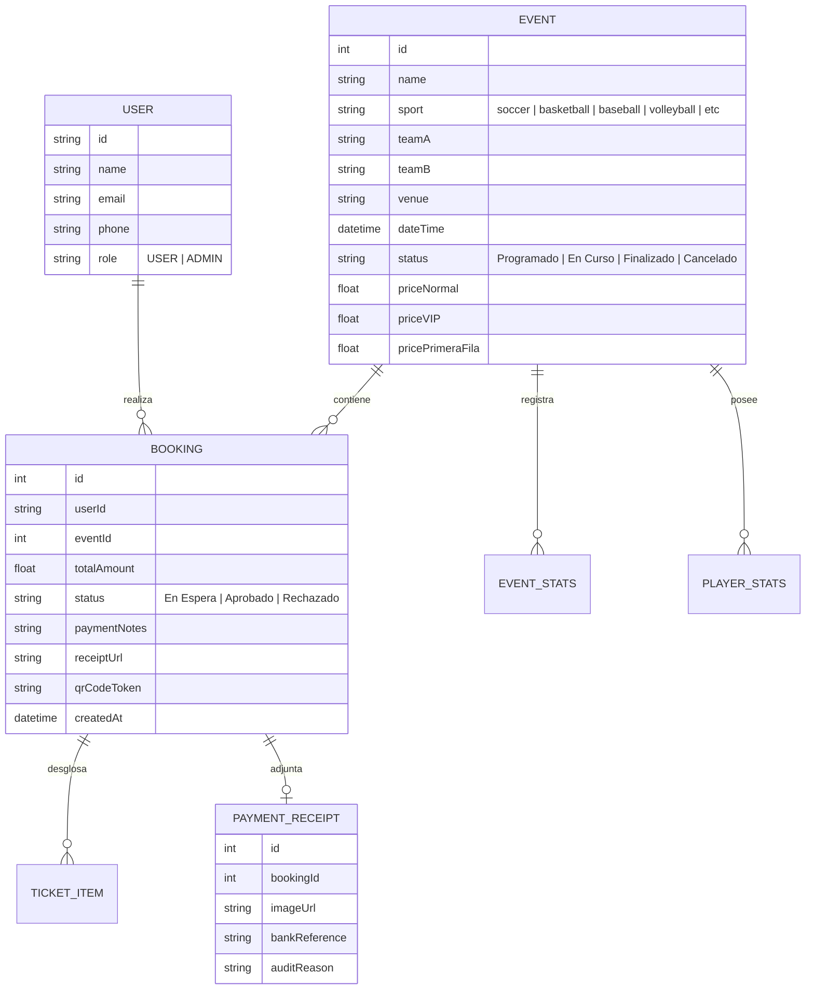

# Plan de Desarrollo MVP: Plataforma SPORT-FLOW (CaraboboSports)

## 1. Resumen Ejecutivo y Alcance del MVP

El objetivo de este proyecto es construir un **MVP demostrativo y 100% funcional** para la plataforma deportiva **SPORT-FLOW** (tematizada con la identidad deportiva de Carabobo: *CaraboboSports*). La solución contempla un **Backend en Node.js** y un **Frontend en React.js**, integrando los dos grandes perfiles de usuario identificados en los requerimientos visuales:

1. **Portal Público y de Aficionados (User Flow)**: Catálogo de eventos en vivo y programados, reserva de entradas con carga de comprobante de pago bancario/móvil, visualización de pases digitales con código QR y consulta de estadísticas detalladas por disciplina deportiva.
2. **Portal Administrativo y de Gestión (Admin Flow)**: Panel de control ejecutivo con KPIs en tiempo real, creación y programación de torneos, verificación/aprobación de pagos con visor de comprobantes, carga de marcadores y estadísticas en vivo, y módulos de auditoría para eventos, ventas y pagos.

---

## 2. Mapeo de Requerimientos Visuales por Captura

A partir del análisis de las 9 capturas adjuntas, se identifican con precisión las siguientes vistas y componentes clave:

| Imagen | Pantalla / Módulo | Funcionalidades Clave |
|---|---|---|
| **Screenshot 185730** | **Landing Page & Autenticación** | • Hero banner (*"Compete. Follow. Achieve."*) con llamados a la acción. • Torneos destacados y últimos resultados en vivo. • Sección explicativa *"How It Works"* con iconografía temática. • Formularios de Login de Usuario, Registro de Usuario y Login exclusivo de Admin (*Admin Portal*). |
| **Screenshot 190154** | **Dashboard de Usuario & Reserva de Entradas** | • **Event Dashboard**: Selector lateral de deportes (Fútbol, Basket, Voleibol), tarjetas "Live Now" con marcador y próximos eventos. • **Book Ticket**: Modal/flujo para seleccionar tipo de entrada (Normal, Primera Fila, VIP), cantidad, carga de comprobante de pago (*Upload Payment Receipt*), campo explicativo del pago y cálculo total. • **Event Details & Statistics**: Marcador en vivo, gráfico donut de posesión, comparativa de tiros/faltas y tabla dinámica de estadísticas por jugador. • **My Bookings**: Pestañas (Todas, Pendientes, Confirmadas), detalles de orden y **Pase Digital con Código QR** para reservas aprobadas. |
| **Screenshot 190243** | **Resumen Ejecutivo (Admin Home)** | • Barra superior con branding *SPORT-FLOW / CaraboboSports*. • Botones de acción rápida: *+ Crear Nuevo Evento*, *Verificar Pagos*, *Resultados*. • Filtro global por disciplina deportiva. • KPIs en tiempo real: Total Eventos (1,134), Pagos Pendientes (42), Entradas Vendidas (7,822), Recaudación Total ($11,450). • Tabla de Eventos Programados con acciones de Posponer / Cancelar. |
| **Screenshot 190316** | **Crear Nuevo Evento (Admin)** | • Formulario con selección de deporte (Soccer, Baloncesto, Béisbol, etc.). • Inputs para Equipo A y Equipo B. • Selector de sedes locales (*Forum de Valencia*, *Polideportivo Misael Delgado*, etc.). • Pickers de Fecha y Hora del evento. • Configuración de precios por categoría (Normal, VIP) y botón *Publicar Evento*. |
| **Screenshot 190400** | **Carga de Resultados y Estadísticas (Admin)** | • Visualización de partido con estadísticas de equipo (posesión, faltas) y plantilla de jugadores. • Modal de actualización en vivo para ingresar marcador final o en curso de Equipo A y B. • Editor de métricas individuales de jugadores (Puntos, Rebotes, Asistencias, Faltas, etc.). |
| **Screenshot 190414** | **Verificación de Pagos (Payment Audit)** | • Contador de pagos pendientes. • Listado de transacciones con avatar de usuario, monto y estado actual. • Modal de auditoría detallada: Visor interactivo del recibo/comprobante con zoom, explicación del usuario (ej. referencia bancaria Banesco), desglose de entradas adquiridas y botones de acción rápida **Aprobar** y **Rechazar**. |
| **Screenshot 192057** | **Listado Detallado de Eventos (Admin)** | • Tabla de alta densidad con 1,134 eventos simulados, paginación y buscador. • Filtros por deporte y estado: *Finalizado*, *Programado*, *En Curso*, *Cancelado*. • Acciones contextuales: *Ver Detalles*, *Actualizar Puntuación*, *Posponer*, *Cancelar*. |
| **Screenshot 192118** | **Listado Detallado de Ventas por Evento** | • Resumen mensual: Total Entradas Vendidas (15,200), Total Recaudado ($325,450). • Desglose por evento de entradas Normales, Primera Fila y VIP. • Acciones: *Ver Mapa Asientos*, *Descargar Listado Compradores*, *Ver Reporte Ingresos*. |
| **Screenshot 192133** | **Listado Detallado de Pagos de Todos los Eventos** | • Auditoría financiera de transacciones con ID, fecha, deporte, concepto, cliente y monto. • Badges de estado: *Pagado*, *Pendiente*, *Vencido*, *Rechazado*. • Acciones: *Ver Recibo*, *Reenviar*, *Auditar*. |

---

## 3. Arquitectura Tecnológica Propuesta

Para garantizar que el MVP sea **autónomo, rápido de inicializar, visualmente idéntico a las capturas y 100% interactivo**:

### 3.1 Stack de Desarrollo
- **Backend**:
  - **Node.js** con **Express.js**.
  - **Persistencia**: Base de datos ligera embebida (SQLite mediante `better-sqlite3` o motor JSON persistente con seed inicial enriquecido) para garantizar cero dependencias de instalación externa.
  - **Manejo de Archivos**: `multer` para la subida de fotos de comprobantes de pago hacia carpeta `uploads/`.
  - **Datos Semilla (Seed Data)**: Precarga de los 1,134 eventos simulados, equipos locales (Trotamundos BC, Marineros de Carabobo, Uora A, Uora B), usuarios de prueba, transacciones pendientes y comprobantes demostrativos.
- **Frontend**:
  - **React.js 18** inicializado con **Vite**.
  - **Estilos**: Vanilla CSS moderno / CSS Modules con variables de diseño acordes a la paleta oficial (Naranja deportivo `#F36F21`, Azul Marino Profundo `#0A192F`, Blanco y Grises estructurados).
  - **Iconografía**: `lucide-react` para iconos de deportes (fútbol, básquet, béisbol, tenis, natación), silbatos, calendarios y recibos.
  - **Visualización de Datos**: Gráfico donut interactivo de posesión y barras de estadísticas de equipo.
  - **Pases Digitales**: `qrcode.react` para generación dinámica del código QR escaneable por cada reserva confirmada.
  - **Barra de Demostración (Demo Switcher)**: Switch flotante en la cabecera que permite alternar con 1 clic entre la vista de **Usuario Aficionado** y **Administrador de CaraboboSports**, facilitando una presentación ejecutiva fluida.

---

## 4. Modelo de Datos y Entidades

---

## 5. Endpoints Principales de la API (Node.js)

### Autenticación y Perfil
- `POST /api/auth/register` - Registro de nuevos usuarios aficionados.
- `POST /api/auth/login` - Inicio de sesión (con validación de credenciales y rol).
- `GET /api/auth/me` - Consulta de usuario activo y cambio rápido de perfil demo.

### Eventos y Estadísticas
- `GET /api/events` - Catálogo de eventos con filtros (deporte, estado, búsqueda por texto) y paginación.
- `GET /api/events/:id` - Detalle completo de un evento, incluyendo alineaciones y estadísticas.
- `POST /api/events` - Creación de un nuevo evento deportivo (Solo Admin).
- `PUT /api/events/:id/status` - Cambio de estado de evento (Posponer, Cancelar, En Curso, Finalizado).
- `PUT /api/events/:id/scores-stats` - Actualización de marcadores y estadísticas individuales de jugadores.

### Reservas y Venta de Entradas
- `POST /api/bookings` - Envío de reserva de entradas con carga multipart de comprobante de pago (`receipt`).
- `GET /api/bookings/my-bookings` - Consulta de reservas del aficionado actual (filtrable por Todas, Pendientes, Confirmadas).
- `GET /api/bookings/:id/pass` - Datos del Pase Digital con token QR generado tras aprobación.

### Verificación de Pagos y Auditoría (Admin)
- `GET /api/admin/payments/pending` - Listado de pagos pendientes de auditoría con comprobantes adjuntos.
- `POST /api/admin/payments/:id/approve` - Aprobación de pago (cambia reserva a 'Confirmada' y genera el QR).
- `POST /api/admin/payments/:id/reject` - Rechazo de pago con motivo registrado (ej. 'Recibo ilegible').
- `GET /api/admin/reports/summary` - KPIs ejecutivos (Total Eventos, Pagos Pendientes, Entradas Vendidas, Recaudación).
- `GET /api/admin/reports/sales-by-event` - Listado detallado de ventas por evento con desglose por tipo de ticket.
- `GET /api/admin/reports/all-payments` - Auditoría completa de todas las transacciones históricas.

---

## 6. Plan de Ejecución Paso a Paso

### Fase 1: Inicialización del Proyecto y Arquitectura Base
1. Crear la estructura del proyecto en el workspace:
   - `/server` (Backend Node.js + Express).
   - `/client` (Frontend React.js con Vite).
2. Configurar scripts en `package.json` raíz o independientes para arranque simultáneo con un solo comando.
3. Configurar el almacenamiento estático para carga y previsualización de imágenes de comprobantes.

### Fase 2: Desarrollo del Backend y Datos Demostrativos
1. Desarrollar el servidor Express con middlewares de CORS, JSON y `multer` para uploads.
2. Implementar los controladores para eventos, reservas, verificación de pagos y estadísticas.
3. Generar el script de **Seed Data** que inserte exactamente los registros visibles en las capturas:
   - Partidos emblemáticos (Uora A vs Uora B, Trotamundos, Marineros).
   - Sedes de Carabobo (*Forum de Valencia*, *Polideportivo Misael Delgado*, *Estadio José Bernardo Pérez*, etc.).
   - Muestras de comprobantes bancarios precargados para la prueba de verificación.
   - Historial de 1,134 eventos simulados con paginación funcional.

### Fase 3: Desarrollo del Frontend - Portal de Aficionados (User Flow)
1. **Landing Page y Autenticación**:
   - Cabecera deportiva con paleta CaraboboSports.
   - Sección de torneos destacados, marcadores recientes y banner de llamados a la acción.
   - Modales/pantallas de Login y Registro de usuario con validación.
2. **Dashboard de Eventos**:
   - Barra de búsqueda y selector de disciplinas deportivas con iconos.
   - Carrusel de partidos "En Vivo" y listado de eventos programados.
3. **Flujo de Reserva de Entradas (Book Ticket)**:
   - Selector de niveles (Normal, Primera Fila, VIP) con cálculo automático de totales.
   - Input de carga de imagen de comprobante y campo de detalles adicionales de transferencia.
4. **Módulo de Mis Reservas & Pase Digital QR**:
   - Pestañas *Todas*, *Pendientes* y *Confirmadas*.
   - Renderizado del **Pase Digital** interactivo con código QR dinámico cuando la entrada esté aprobada.
5. **Estadísticas de Partido**:
   - Marcador en vivo y gráfico donut de posesión.
   - Tabla interactiva de rendimiento de jugadores (puntos, asistencias, faltas, tarjetas).

### Fase 4: Desarrollo del Frontend - Portal Administrativo (Admin Flow)
1. **Login de Administrador**: Portal restringido con vista ejecutiva.
2. **Resumen Ejecutivo**:
   - Tarjetas métricas (KPIs) con actualización reactiva tras aprobar pagos o crear eventos.
   - Tabla de torneos programados con botones para posponer o cancelar.
3. **Formulario de Creación de Eventos**:
   - Selección de deporte, contendientes, sedes locales, fechas y precios de entradas.
4. **Módulo de Verificación de Pagos**:
   - Bandeja de pagos pendientes.
   - Modal de inspección con visor de comprobante en alta resolución, desglose de entradas y botones de **Aprobar** / **Rechazar**.
5. **Carga de Resultados y Estadísticas**:
   - Modal para actualizar marcadores de partidos y estadísticas individuales de jugadores.
6. **Reportes Masivos**:
   - Listado detallado de todos los eventos (con paginación y buscador).
   - Reporte de ventas por evento y reporte de auditoría general de pagos.

### Fase 5: Integración, Barra Demo y Pruebas
1. Conectar frontend con las APIs del backend de forma reactiva.
2. Añadir selector flotante de perfiles ("Ver como Usuario" vs "Ver como Administrador") para facilitar la demo en cualquier momento.
3. Probar el ciclo de vida completo:
   - *Paso 1*: Aficionado reserva entrada y sube comprobante -> Estado 'En Espera'.
   - *Paso 2*: Admin abre 'Verificar Pagos', inspecciona recibo y hace clic en 'Aprobar'.
   - *Paso 3*: Aficionado recarga 'Mis Reservas' y obtiene su Pase Digital con QR listo.
   - *Paso 4*: Admin crea nuevo evento y actualiza marcadores en vivo, reflejándose de inmediato en la vista del usuario.
4. Documentar el comando de arranque e instrucciones en un `README.md`.

---

## 7. Entregables Esperados
- Código fuente limpio y desacoplado (`server/` y `client/`).
- Base de datos inicializada con datos semilla representativos de las 9 capturas.
- Aplicación lista para correr con `npm run dev` en frontend y backend.
- Experiencia visual moderna y pulida con la estética deportiva naranja y azul de *SPORT-FLOW*.
